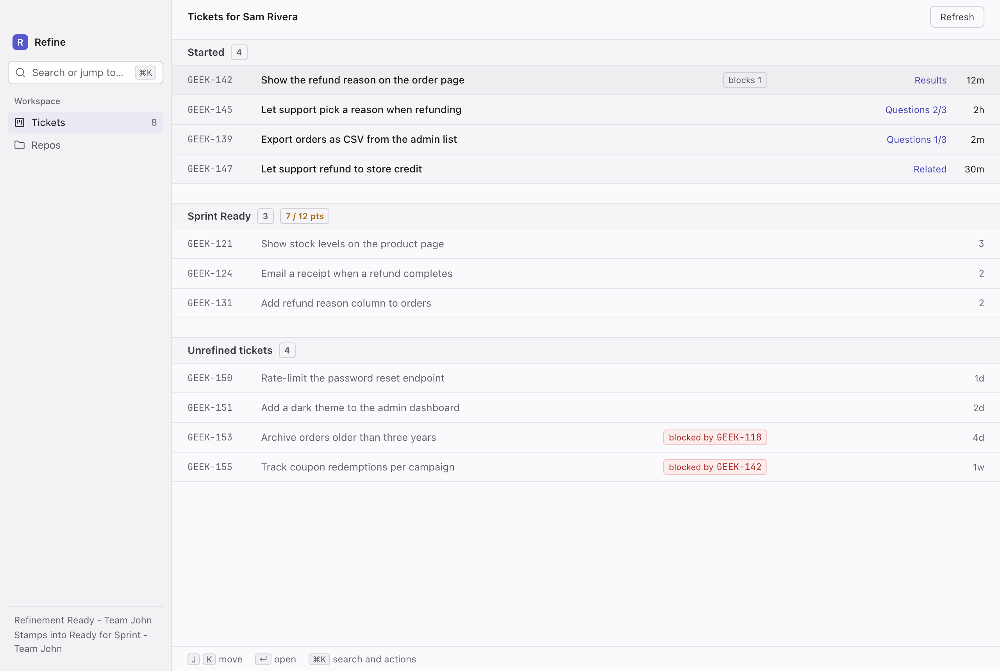
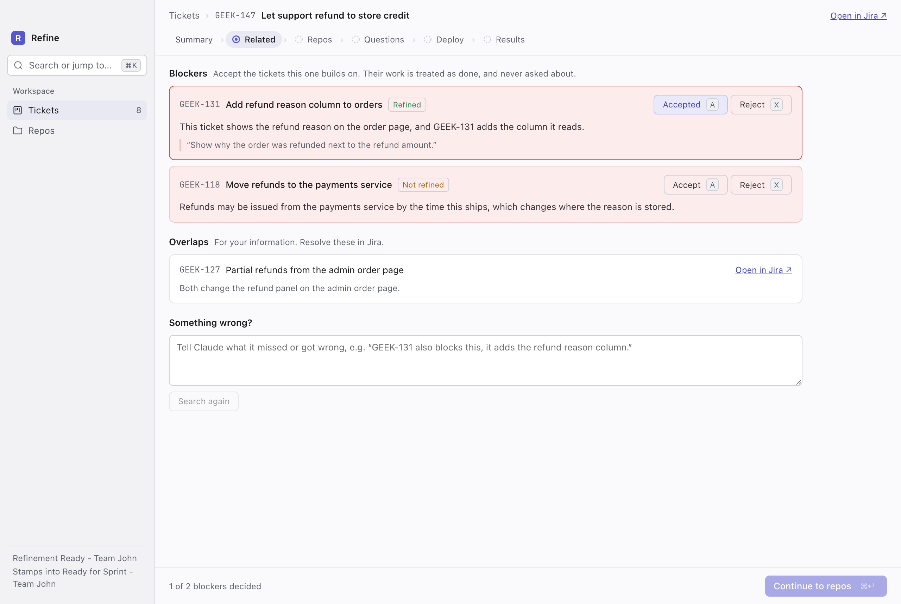
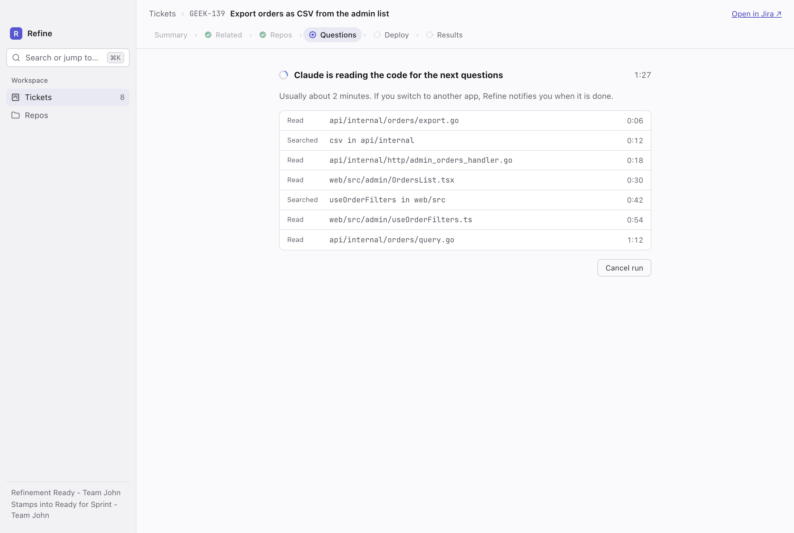
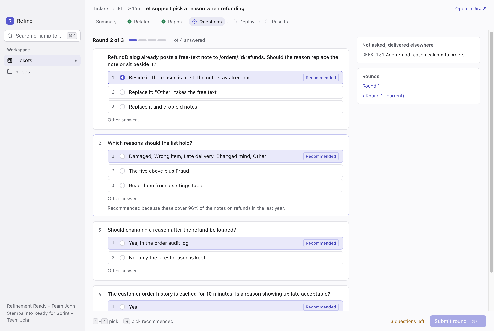
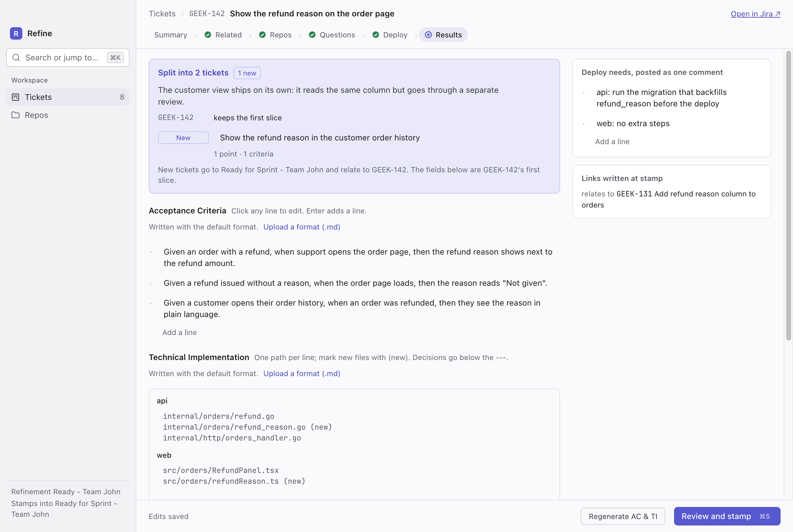

# refine

refine refines Jira tickets with Claude Code. Pick a ticket from the
refinement sprint and it walks you through one step after another:

1. **Related**: the tickets that overlap this one, and which of them block it.
2. **Repos**: the repos the work touches. refine fetches each one's `develop`
   (or origin's default branch) into its own worktree, so your checkout is
   never touched.
3. **Questions**: up to 3 rounds of up to 5 questions, asked after Claude has
   read the code.
4. **Deploy**: what shipping the change needs, per repo.
5. **Results**: Acceptance Criteria, Technical Implementation, points and any
   split tickets, for you to review.
6. **Stamp**: writes the fields, comments the deploy needs, creates the split
   tickets, links the blockers and moves the ticket to the ready sprint.

Go decides everything with one right answer: which tickets to show, how many
questions, the points, the Jira writes. Claude (`claude-opus-5-5`, run
headless and read-only) only judges.

## Screenshots

The tickets in these are made up.

The tickets in the refinement sprint, started ones on top:



Related: accept or reject the blockers Claude found.



Claude reads the code before each round of questions:



Questions: pick an option, the recommended one, or write your own.



Results: edit anything in place, then review and stamp.



## Requirements

- macOS
- Go 1.26
- Node and pnpm
- `make`, from the Xcode Command Line Tools (`xcode-select --install`), which
  `git` needs too
- [Claude Code](https://claude.com/claude-code) (`claude`) and `git` on your
  login shell's PATH
- An Atlassian API token

## Setup

Copy the example config, readable by you alone since it holds your token:

```sh
mkdir -p ~/.config/refine
cp config.toml.example ~/.config/refine/config.toml
chmod 600 ~/.config/refine/config.toml
```

Then fill in your email, and an API token created in your
[Atlassian account's security settings](https://id.atlassian.com/manage-profile/security/api-tokens).
refine refuses to start when others can read a config that holds a token.

Every key it takes:

```toml
[jira]
site = "geekee.atlassian.net"
email = "you@example.com"
token = "..."
# Optional; these are the defaults.
project = "GEEK"
sprint = "Refinement Ready - Team John"
ready_sprint = "Ready for Sprint - Team John"

[repos]
api = "~/develop/api"
web = "~/develop/web"
```

Repos can also be added and removed from the app. `REFINE_JIRA_TOKEN`, when
set, takes the place of the token in the file.

How Acceptance Criteria and Technical Implementation are written lives in
`~/.config/refine/ac.md` and `~/.config/refine/ti.md`, created with the
defaults on first run. Upload a different file for either from the Results
page, then Regenerate AC & TI to rewrite them with it.

## Run

```sh
make dev     # installs the app's packages, builds bin/refine, runs the app with hot reload
make dist    # builds desktop/dist/mac*/refine.app with the binary bundled
```

See [desktop/README.md](desktop/README.md) for how the app talks to the
backend and the environment variables it reads (`REFINE_BIN`,
`XDG_STATE_HOME`).

refine keeps its state in `~/.local/state/refine`: `refine.db`, `hidden.json`
and the worktrees Claude reads.

## Layout

```
cmd/refine          the backend binary: refine serve, refine version
internal/refine     the step flow, prompts and output schemas, the stamp
internal/claude     runs headless Claude Code for one step
internal/jira       the Jira client
internal/server     the HTTP API the app calls
internal/store      refinements and deploy profiles in SQLite
internal/gitcmd     runs git with no password prompts
internal/gitsync    fetches the branch Claude reads
internal/worktree   checks it out into a refine-owned worktree
desktop             the Electron app
spike               the original headless-Claude spike
```

## Test

```sh
make test    # go test ./... and the app's typecheck
make lint    # golangci-lint, configured in .golangci.yml
```

## Flags

`VITE_RERUN_QUESTIONS=1` at build time shows a button that drops the question
rounds and asks round 1 again.
